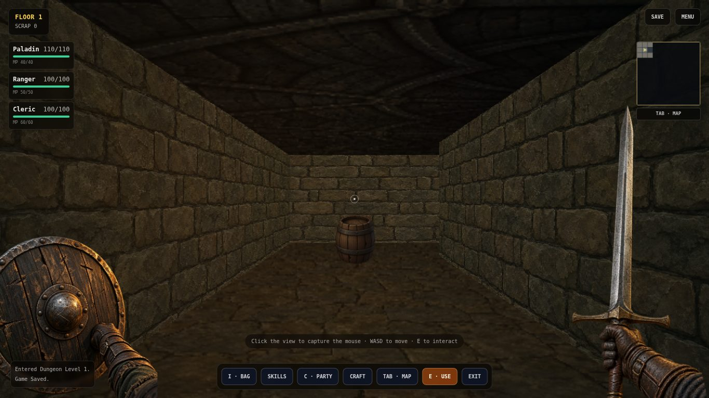
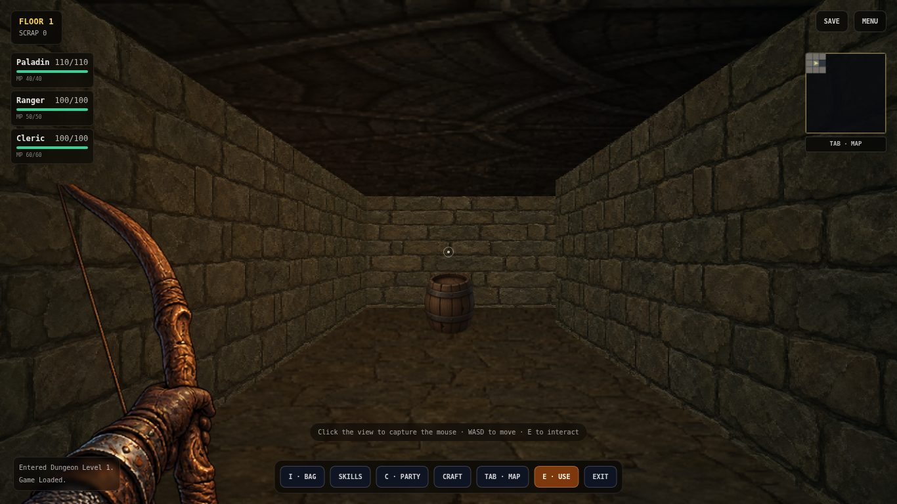
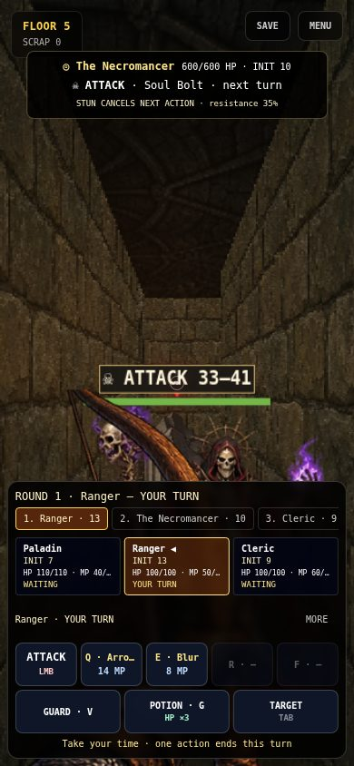
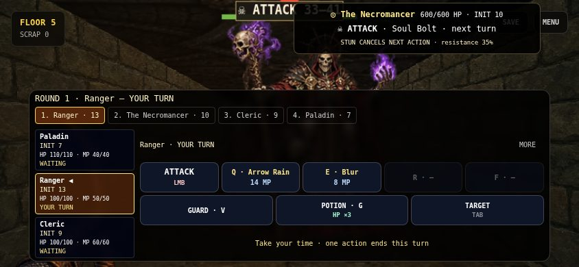

# Combat — initiative rounds

Current behavior after the turn-based follow-up to PR #9. This replaces the Combat 2.5A/B wall-clock timelines and the earlier initiative-speed formula. Existing damage, skills, enemy ability selection, boss phases, rewards and exploration remain integrated.

## Turn ownership

Each living participant gets **one action per round**. Effective initiative sorts all heroes and monsters together, highest first. Ties use stable actor ID order, independently of array/party order. No random initiative roll or extra fast-actor turn is added.

Class base initiative remains: Barbarian 9, Paladin 8, Sorcerer 10, Rogue 14, Ranger 13, Cleric 9, Monk 14, Necromancer 9. Equipment load subtracts Light/Medium/Heavy armor 1/2/4 and shield 1, with minimum effective INIT 1. Legacy armor defaults to medium. A starting Ranger acts at INIT 13, a shield-bearing Paladin at INIT 7; a rat at 16 can precede both. Existing saves retain their base initiative and weights; no new save version or combat persistence is introduced.

The round queue is built from living eligible actors. The active hero waits indefinitely. One accepted Attack, Guard, skill, potion or Flee consumes their turn; an invalid/unaffordable action leaves ownership and resources unchanged. Failed escape still costs the action, and bosses still prevent escape. Other heroes cannot bypass initiative by clicking their cards or using party keys. Keyboard repeat is ignored by the existing input owner.

The HUD displays the round, current actor and the remaining queue. Completed actors are marked ACTED, newly revived actors NEXT ROUND. The queue scrolls horizontally on narrow displays. Initial selection and later automatic focus follow the hero whose turn it is. Target switching and skill/potion details do not consume actions. Q/E/R/F, V, G, Tab and LMB retain their action/target roles. Space/B have no combat automation or pause function. There is no Auto Basic, skill buffer, real-time recovery or tactical slowdown.

## Enemy turns and intents

Each enemy resolves its advertised intent on its own turn, then plans its next intent. A 1000 ms UI presentation delay separates enemy actions; it does not simulate gameplay time. It never runs during a hero decision. Menu/map/skill details suspend pending enemy presentation, as does a hidden document. Closing a menu waits a fresh delay; there is no catch-up burst.

The runtime exposes explicit `act` and `stepEnemy` transitions and owns no wall-clock timers. A step carries expected actor ID and round; stale callbacks are rejected, including the same enemy becoming first in the next round. Hook cleanup cancels pending presentation on overlay/encounter changes and delivers terminal outcomes once.

Intents now say **next turn**, with heavy/prepare/summon labels and interruptibility. Old authored cast/recovery milliseconds remain legacy content metadata, but are not combat timing or shown as countdowns. Orc Wind Up → Crushing Blow → Recover and Necromancer ritual preparation remain separate ability turns. Boss phase transitions preserve an already advertised intent and influence the following plan.

## Guard, stun, statuses and lifecycle

Guard halves incoming damage before existing armor/shield reduction and lasts until the start of the guarding hero’s next turn. It cannot expire while reading a menu. Completion/escape clears all guard flags.

Hero poison/burn/regeneration and effect durations tick once at the beginning of their own turn, before action. A stunned hero loses that turn; other effects tick once even when stunned. Status death removes the actor from the queue and can end the encounter immediately.

Enemy statuses tick once in the existing enemy-intent resolver on that enemy’s turn. Accepted Stun cancels an interruptible advertised action and consumes that turn; uninterruptible actions and per-ability boss resistance remain in force. Cancellation flags and previous ability/cooldown logic prevent immediate heavy/ritual repetition. No duplicate mid-cast tick path remains.

Defeated actors leave the queue immediately. Summons and revivals become eligible **next round**, sorted by their initiative, so they cannot attack inside their creator’s action. Enemy/summon caps, reward exclusions for summons, theft settlement, phase/split mechanics, victory/defeat/escape latching and one-time room rewards retain their existing owners. Healing still supports the existing lowest-health-ally/revival behavior.

Saving remains exploration-only. Save migration stores base initiative independently of equipment load; no turn queue or partially resolved combat is serialized.

## First-person hand correction

`services/handPresentation.ts` describes which hand owns each visual. Existing empty-hand and weapon sources were authored for the right hand, while the painted shield is already left-handed. The renderer now mirrors the empty-hand source for the left offhand and keeps the shield unmirrored. Right melee/staff weapons anchor at the lower right; the painted sword rotates slightly inward around the forearm anchor rather than leaning out of frame. All sprites preserve their source aspect ratio.

The bow is mirrored and placed in the left hand. Its ready pose does not also draw an empty left hand or a shield, avoiding the old duplicated-hand composition. This is presentation only: it adds no new equipment restrictions or shooting animation, and a mechanically equipped shield retains its existing stats. Later equipment work can define two-handed restrictions explicitly. No raster assets were edited or generated for this fix; existing sprites use Canvas transforms.

## Validation and limits

- `npm test`: 119 tests in 13 files passed. The replaced timeline tests now assert turn ownership, mixed initiative rounds, stable ties, unlimited decision waits, double-command rejection, guard duration, stun/status timing, boss intents/phases, summons, revivals, potion/flee costs, terminal outcomes and save migration. Three tests cover hand layout decisions.
- `npm run typecheck` and `npm run build`: passed.
- `git diff --check`: passed.
- Actual local Chromium 153 / Playwright: new game with Paladin/Ranger/Cleric, Floor 1 save, Continue and Party Stats; all seven weapon visual types captured and visually inspected on desktop.
- Generated Floor-5 exit save fixture → Necromancer: the Ranger stayed unchanged through 5 seconds of idle waiting and 2 seconds in skill details. A wrong-hero hotkey could not change ownership. Arrow Rain consumed 14 MP; an enemy step then handed control to the Cleric, whose state stayed unchanged for another 3 seconds. An open detail menu also held an enemy turn for 1.8 seconds before resolution resumed.
- Touch emulation at 390×844 and 844×390: boss HUD, turn order, Guard and subsequent enemy/hero handoff; all 12 visible dock buttons were inside each viewport and at least 44×44 px. No page/console errors. Screenshots were inspected at both sizes.
- Separate boss-outcome fixture with a strengthened level-50 party: one-turn Necromancer victory returned to exploration, granted XP/loot once, saved the defeated-guardian flag, reloaded it, then descended explicitly to Floor 6 while retaining inventory. This checks the outcome boundary, not encounter balance.
- Browser fixtures are not a played five-floor run; touch emulation is not a physical phone test.

Not accepted by this change: a full ordinary-party Floors 1–5 playthrough, physical-phone performance/comfort, or final combat balance. Initiative now changes order rather than action frequency; expensive/AoE skills no longer pay a longer recovery and need playtest observation. No world-space enemies, navigation, new combat abilities or expanded art wave.
