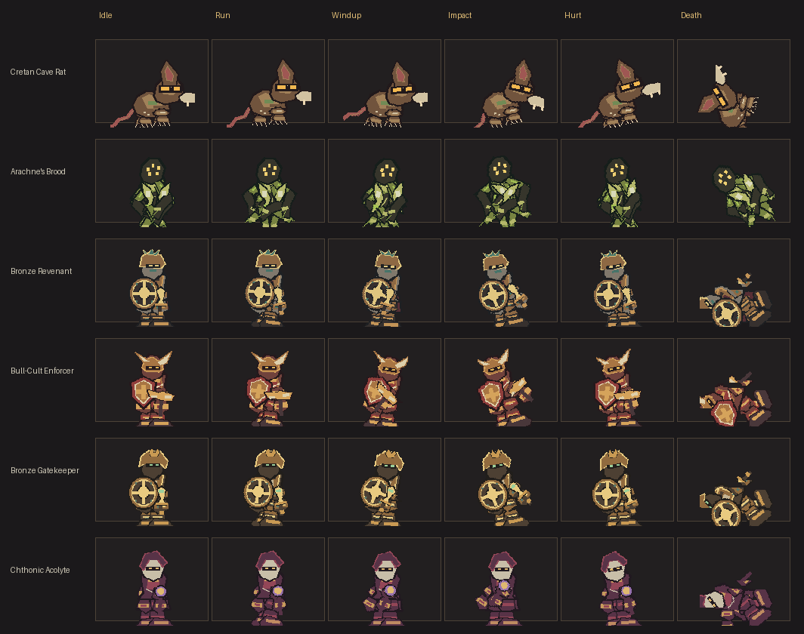

# FPS-R3A Character Rigs and Animation Runtime

## Scope and audit

R3A replaces the six selected enemies' single-image billboard motion with locally authored, anatomy-specific pixel layers. Before this wave, their local enemy images could identify each creature, but they did not provide separated joints or combat poses. `SpriteAnimator` supplied broad whole-sprite motion; the first-person weapon presenter used a small set of generic sweeps and thrusts. Other enemy visuals continue through that legacy renderer.

The existing world simulation remains authoritative. `SceneRenderer` owns one visual instance for each enemy, and the renderer selects poses from the current `WorldEnemy` state, attack ID, attack definition, and remaining state timer. No combat state, collision, damage, reward, floor descent, or save field was added.

| Pilot / stable visual ID | Prior art and gap | R3A anatomy and layers | Existing attack profiles used for poses |
| --- | --- | --- | --- |
| Cretan Cave Rat / `cretan_cave_rat` | Local static rat image; no joint poses | Quadruped: body, head, ear, muzzle, eye, tail, four independently articulated two-part legs (14 layers) | `rat_bite`, `rat_leap` |
| Bronze Revenant / `bronze_revenant` | Local static revenant image; no joint poses | Humanoid: cloak, torso, head, paired two-part arms and legs, feet, weapon, shield (15 layers) | `revenant_xiphos`, `revenant_shield_bash`, `revenant_shield_guard` |
| Arachne's Brood / `arachne_brood` | Local static arachnid image; no articulated limbs | Arachnid: abdomen, thorax, head, paired fangs, eight two-part legs (21 layers) | `spider_venom_fang`, `spider_web_projectile`, `spider_side_lunge` |
| Bull-Cult Enforcer / `bull_cult_enforcer` | Local static brute image; no joint poses | Heavy humanoid: broad torso, bull head and horns, paired two-part arms and legs, feet, club, shield (14 layers) | `enforcer_heavy_cleave`, `enforcer_charge`, `enforcer_roar` |
| Bronze Gatekeeper / `guardian_bronze_gatekeeper` | Local static Guardian image; no joint poses | Heavy humanoid: scaled Guardian armor, paired two-part arms and legs, feet, weapon, shield (14 layers) | `gatekeeper_shield_bash`, `gatekeeper_sweep`, `gatekeeper_guard` |
| Chthonic Acolyte / `chthonic_acolyte` | Local static caster image; no joint poses | Caster: robe and cloak, hooded head, paired two-part arms and legs, feet, staff (14 layers) | `acolyte_underworld_bolt`, `acolyte_curse`, `acolyte_votive_ward` |

All other visual IDs keep their original static pixel sprites and existing fallback animation.

## Art and generated data

The six pilots use hand-authored pixel shapes, deliberate palette clusters, explicit attachment points, pivots, draw order, and per-layer pose data. R3A does not cut up the old full-body sprites. It renders 53 authored source cells in a 16-by-8 atlas; repeated part artwork shares cells, while the manifest has 92 layer instances across the six rigs.

The generator is local and deterministic:

- Source and pose authoring: `scripts/character_rig_authoring.py`
- Existing asset entry point: `scripts/generate-maze-assets.py`
- Runtime manifest: `data/generated/characterRigs.json`
- Pixel atlas: `public/assets/maze/characters/character_rigs.png` (1024 × 512, 64-pixel cells)
- Six-character contact sheet: [`previews/FPS_R3A_CHARACTER_CONTACT_SHEET.png`](previews/FPS_R3A_CHARACTER_CONTACT_SHEET.png)

The contact sheet shows Idle, Run, Windup, Impact, Hurt, and Death for each pilot. The same generated manifest drives the runtime atlas mapping. The Python generator checks atlas bounds, pivots, layer parents, clip timing, and references before writing the outputs.

## Runtime and pose selection

`data/enemyCharacterAnimation.ts` is a pure selector over existing simulation data. Its priority is **Dead → Stagger → Hurt → Attack → Alert → Movement → Idle**. `ALERT` and the initial `AGGRO` state use the alert pose; chase and reposition states use the run cycle. The run phase advances by actual enemy displacement divided by a rig-family stride length, so a blocked enemy settles into Idle instead of running in place.

Windup, active, and recovery clips use the matching `EnemyAttackDefinition` durations and the state's remaining timer. Stable attack IDs in each rig select authored attack profiles; unknown IDs fall back to the existing attack shape and motion. Cast and guard attacks use their own poses. Hurt, stagger, and death override attacks; the dead pose holds until the simulation removes the enemy. Save/load rebuilds the same visual from the saved simulation fields.

`presentation/CharacterRigAnimator.ts` creates one upright billboard group per pilot enemy. The group contains prepared atlas-backed layer meshes with anatomy-specific parent pivots. Each instance reuses one material and its prepared geometries throughout updates. `AssetManager` owns the lazily loaded atlas; actor cleanup releases only that actor's material and geometries. `SceneRenderer` switches from the legacy image to a rig when the atlas is ready, disposes instances on enemy removal and floor rebuild, preserves depth testing, and retains the legacy path for non-pilots.

## First-person weapon presentation

`WeaponPresenter` reads the current equipped `visualType` and active `AbilityDefinition`. Each pose follows that ability's actual windup, active, and recovery timing. Labrys, Kopis, and Xiphos have different anticipation and swing arcs; the Dory stays centered and thrusts through camera depth; the bow draws and releases; staff casts stay upright without a melee swing; and the Aspis has separate guard and bash poses. The sprites remain camera-relative. No weapon or cast sprite is spawned into world coordinates.

## Validation and limits

Unit coverage checks manifest paths and pivots, anatomy families, pose endpoints, combat priority and phase timing, interruption, save/load reconstruction, viewer-facing flip, resource ownership, weapon poses, and equipment changes. The generated contact sheet is an art review surface, not a WebGL scene capture.

| Check | Result |
| --- | --- |
| Local generator run twice | Pass; manifest, atlas, and contact-sheet SHA-256 values matched between runs |
| `npm run typecheck` | Pass |
| `npm test` | Pass; 19 files and 179 tests |
| `npm run build` | Pass; Vite reports the Three.js chunk above its 500 kB advisory threshold (533.61 kB, 131.95 kB gzip) |
| `git diff --check` | Pass |
| Browser/WebGL smoke | Not run; Playwright's Chromium executable is not installed in this environment |

Browser/WebGL scene review for crowd sizes, wall occlusion, close/far framing, and viewport aspect ratios remains open for a machine with Chromium and WebGL available. R3A does not claim measured performance or a gameplay/balance sign-off. The rig remains a 2D billboard with layered pixel planes; it does not provide volumetric views.

## R3B handoff

R3B owns the broader mythic VFX production and further authored animation content. Extend the current rig data only for selected enemies with real source art and distinct anatomy. Keep world-space effects tied to simulation positions and camera-space weapons tied to the player view. Any new visual reaction should continue to consume existing gameplay events and state rather than add a second combat state machine.
