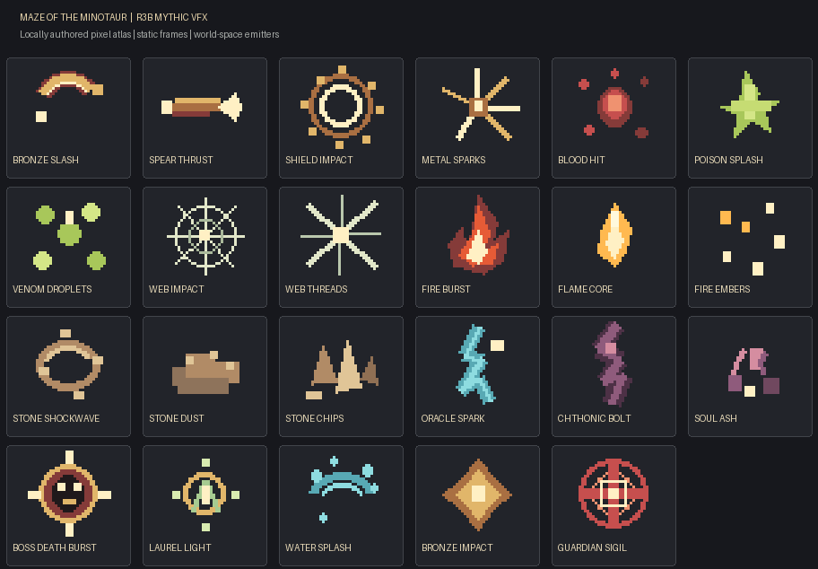

# FPS-R3B Mythic VFX and World Combat Feedback

## Scope and audit

R3B builds on the merged R3A weapon presentation and the active R2B combat simulation. It changes the visual and audio response layer; `FPSGameRuntime` still owns damage, status, projectile, reward, and Guardian phase state. The renderer consumes the resulting events and positions.

The R2B code already had a fixed pool of 48 sprites and cached procedural textures in `AssetManager`, so it did not allocate new textures for every hit. The audit found these concrete gaps:

- The pool used a round-robin cursor. A new burst could replace any in-flight effect without considering age or importance.
- `SceneRenderer.syncProjectiles` emitted the same small Oracle spark trail on every render for every active projectile. Trails had no projectile identity or throttle.
- Projectile expiry at maximum range was reported as an impact and rendered like a contact. Runtime projectile launch and contact also shared a broadly generic effect path, with no known wall/door material response.
- The effect catalog had no data model for layer timing, palette, projection, priority, or reduced mode. Effects were camera-facing sprites, including ground shockwaves.
- The renderer and runtime described Guardian warning geometry separately. There was no shared descriptor or alignment test for the attack footprint.
- Render effects continued updating while simulation state was paused.

## Effect families and authored assets

The data-driven registry defines the required families: Bronze Slash, Dory Thrust, Aspis Block/Bash, Blood Hit, Arachne Venom, Web Snare, Promethean Flame, Stone Shockwave, Oracle Spark, Chthonic Bolt, Guardian Sigil/Windup, and Guardian Death. Composite definitions layer static pixel frames with bounded counts, individual lifetimes, palette, motion, orientation, opacity/scale curves, and render order. Lingering-area emitters remain unused because the current combat model has no persistent gameplay area requiring them.

Twenty-three transparent frames are authored locally in `scripts/mythic_vfx_atlas.py`. `scripts/generate-maze-assets.py` runs the atlas generator alongside the existing asset pipeline. The manifest provides fixed atlas coordinates; `AssetManager` loads one nearest-filtered atlas, prepares frame views once, and falls back to cached procedural textures if the local image cannot load. The gallery shows each source frame and its stable effect ID:

## Gameplay timing and world response

| Gameplay event | Presentation response |
| --- | --- |
| Melee action reaches its active window | A directional weapon arc appears at the sweep position. Contact effects are emitted only for IDs returned by the real melee hit test. |
| Player or enemy projectile launches | A cast cue appears at the actual launch origin. A small, throttled trail follows the live projectile position. |
| Projectile contacts an enemy or player | One impact event is emitted at the collision point, with its status and known target material. |
| Projectile contacts a wall or door | The collision tile selects stone chips/dust or bronze sparks. Range-only expiry is suppressed as a visual impact. |
| Enemy is defeated | `rewardGranted` gates one death event and the existing reward release. Guardians use the short layered Guardian Death effect. |
| Floor revision changes | The renderer clears active pooled VFX before rebuilding the world geometry. |

All VFX instances are world-space planes. First-person weapons remain camera-relative through the existing R3A presenter. The effects do not own simulation timers or add damage logic. Trail intervals are 55 ms in Full mode and 110 ms in Reduced mode; their clock entries are removed when a projectile leaves the active set.

Material responses use only facts present in the current level model: known bronze NPC visuals map to metal, known stone NPC visuals map to stone, doors map to metal, and solid wall/locked/secret cells map to stone. Unknown enemy visuals remain organic, and unknown solid tiles use the safe stone response. The tile model contains no water/cistern collision type, so the water splash frame is registered for a future known water surface but is not assigned speculatively.

## Guardian threat readability

`data/enemyAttackTelegraph.ts` supplies the warning center, radius, arc, and projection descriptor to both the renderer and runtime hit test. Cone and charge warnings use the same range-plus-collision allowance as their active hit shape; slam, ritual, and delayed-sigil attacks share their declared radius. Target-centered sigils use the simulation's telegraph position. Arc and line tells also show a narrow direction trace. The Serpent Cone, Cyclopean Shockwave, Lamia Lunge Trace, and Warden Delayed Sigil receive their own authored windup marker; the floor outline remains present for the full windup and communicates shape independently of color.

The marker mesh renders below the brighter outline. These tactical warning meshes stay available when VFX are Off, so disabling decorative combat effects does not remove the attack tell.

## Audio, accessibility, and budgets

Combat cues use `AudioContext.currentTime` for category cooldowns and stable, subtle position-based pitch variation. Impact, action, telegraph, phase, death, reward, and movement categories prevent repeated cues from layering loudly. No wall-clock time participates in VFX or combat-audio decisions.

Controls & Options provides persisted Full, Reduced, and Off presentation modes under a separate local preference key. Reduced suppresses ambience, halves multi-particle layer counts, lowers active effect brightness, and throttles projectile trails. Off clears and stops pooled VFX while leaving Guardian floor tells intact. Neither option changes the existing solo save schema or progress.

The world-effect pool is fixed at 48 slots on desktop and 24 on mobile. Each slot owns one prepared plane geometry and material. The priority order is `guardian_telegraph > critical_hit > ordinary_hit > ambience`; allocation reuses a free slot or the oldest effect at the lowest replaceable priority. Existing effects with higher priority remain intact. Atlas views and fallback textures are cached, and render updates create no texture, material, or geometry objects.

## Validation and limits

| Check | Result |
| --- | --- |
| `npm run typecheck` | Pass |
| `npm test` | Pass; 21 files and 193 tests |
| Local asset generator | Pass; two full runs produced matching hashes for all 198 generated asset, manifest, and preview files |
| `npm run build` | Pass; Vite reports the existing Three.js chunk above its 500 kB advisory threshold (537.71 kB, 132.86 kB gzip) |
| `git diff --check` | Pass; checked the R3B text changes against the confirmed `main` baseline |
| Browser/WebGL smoke | Not run; the Playwright Chromium executable and common system browser paths are absent from this environment |

The automated coverage checks the effect registry and atlas references, bounds and priority selection, invalid lifetimes, pause/off/cleanup behavior, Reduced projectile trails, trail-clock pruning, material-specific contacts, range-expiry suppression, one-shot death/reward, and Guardian warning mappings. The generated gallery is a source-art review surface, not a captured game scene. The user owns gameplay feel and balance review; this wave does not claim device performance measurements or Guardian playtest sign-off.

## R4 handoff

- Keep effect triggers attached to existing ability IDs and confirmed simulation events as R4 adds item affixes and class skills.
- Add only distinct local frames and definitions for item/skill visuals; reuse the shared pools, categories, cleanup, and accessibility modes.
- Preserve the save namespace and keep cosmetic mode outside the expedition payload.
- Revisit water splashes only if a water collision surface is added to the level model. Do not add a general destruction system or runtime asset service for this scope.
