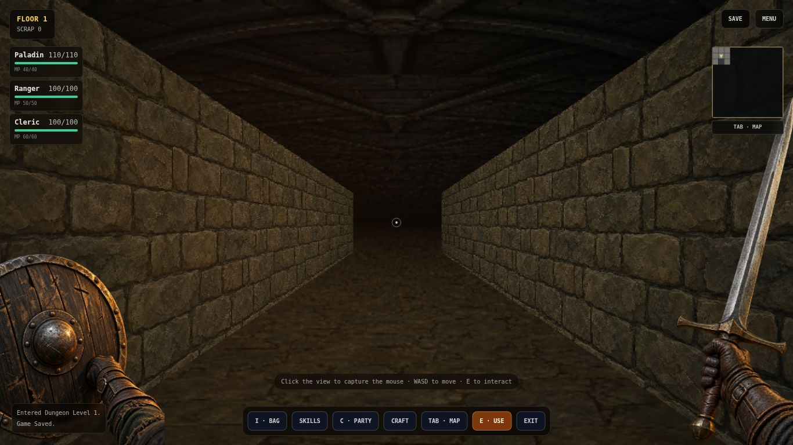
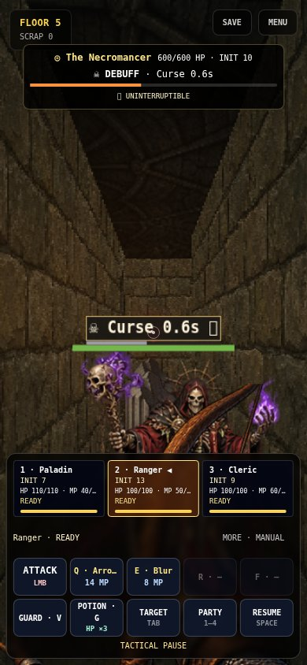

# Initiative and painted dungeon pass — 2026-10-15

Based on `main` after merged PR #8 (`e5c97b9`). This extends the existing independent combat timelines; it does not add a second combat system or spatial enemies.

## Initiative rules

Every class template and all 28 enemy definitions have a base initiative. Higher values shorten initial readiness and subsequent recovery. Heroes remain READY until commanded (or the existing optional Auto Basic acts); initiative does not force player actions.

| Class | Base initiative |
| --- | ---: |
| Barbarian | 9 |
| Paladin | 8 |
| Sorcerer | 10 |
| Rogue | 14 |
| Ranger | 13 |
| Cleric | 9 |
| Monk | 14 |
| Necromancer | 9 |

Equipment subtracts initiative: light armor 1, medium armor 2, heavy armor 4, shield 1. Effective initiative has a minimum of 1. Rarity and defense do not imply weight. Legacy armor without a weight counts as medium. New armor loot explicitly carries a weight, with base defense 1/2/4 plus item tier. No class equipment restrictions were introduced.

Gauge speed is `clamp(1 + (effectiveInitiative - 10) * 0.05, 0.7, 1.5)`. Readiness/recovery duration is `baseDuration / speed`, bounded to 300–5000 ms. Both sides start with the same 1400 ms gauge; party order supplies no speed bonus. Ties become ready together. The fastest living hero is initially selected, then manual selection remains in control.

A starting Ranger has INIT 13 (1.15× speed), becoming READY in 1217 ms and recovering from Attack in 783 ms. A starting Paladin with shield has INIT 7 (0.85×), becoming READY in 1647 ms and recovering from Attack in 1059 ms. Paladin plus heavy armor has INIT 3 (0.70×). Fast rats have INIT 16; stone golems have INIT 5. Enemy action frequency includes their unchanged cast time as well as scaled recovery.

Hero base recovery is 1000 ms, with existing action/skill factors applied before initiative. Enemy authored recovery, stun and interrupt recovery scale with initiative. Enemy cast windups, interrupt rules, 2800 ms Guard windows, tactical pause/slowdown and own-cycle status durations stay on their established semantics. Fast poisoned actors consequently reach their own status cycles sooner. DEX still affects existing damage/defense/crit, not timeline speed. Initiative does not automatically increase on level-up.

INIT is shown in combat, class selection, Inventory and Party Stats. Base value, equipment load and gauge multiplier are available in the latter two. Party Stats previously had a phase/control but no modal; it now opens correctly. On narrow screens INIT has its own line to avoid name truncation. Enemy recovery shows time until casting, followed by the advertised cast and interrupt feedback.

Save/load fills missing/invalid hero base values from their class. It stores the base and equipment separately, preventing load penalties from accumulating across saves. Armor weight round-trips with equipment. Combat timelines are still not saved; saving remains exploration-only as before.

## Painted look

Floors 1–5 now use detailed dark stone, warm amber lighting, a painted arched gate and perspective-sampled ground. Sword and shield foregrounds are larger and preserve image aspect ratio and alpha. Smooth sampling replaces forced nearest-neighbor pixelation. Ground props now project onto the floor according to distance rather than a fixed screen baseline; fresh floor spawns face an available route instead of inheriting a heading into a wall.

New Paladins start with an Arming Sword instead of the old mace, at the same power (4). Existing saves retain their equipment. Other classes keep their existing weapon visuals.

This is an approximation within the existing grid raycaster. True stone vault geometry, outdoor castle scenes and full art conversion are open. Monsters, other weapons, ceiling, lights, props and later biomes retain legacy artwork. The reference's browser/editor controls and edge symbols are not included. Existing gameplay controls remain functional.

## Art provenance

Five original images were generated with the built-in image generator during authoring. The following reproducible brief set describes the supplied prompts; these are new assets inspired by materials, lighting and first-person framing, not crops from the reference screenshot.

| File under `public/assets/` | Generation brief |
| --- | --- |
| `environments/dungeon/painted/wall.webp` | Seamless front-on dark medieval dungeon masonry; large uneven worn stone blocks, deep mortar, earthy charcoal/olive, subtle warm torch illumination, detailed painterly realism; no arch, perspective, objects, UI or text. |
| `environments/dungeon/painted/floor.webp` | Seamless top-down worn stone floor, irregular damp flagstones, brown/olive shadows, detailed painterly realism; flat surface with no horizon, objects, UI or text. |
| `environments/dungeon/painted/gate.webp` | Front-facing arched dungeon gateway in heavy weathered masonry, dark recessed oak/iron door, warm amber/cool green-black atmosphere; opaque square, no characters, UI or text. |
| `hands/painted/sword.webp` | First-person right leather-gloved hand and forearm gripping a long worn steel arming sword with understated brass crossguard; blade rises diagonally upward, detailed dark fantasy painted realism, transparent background, no shield, UI or text. |
| `hands/painted/shield.webp` | First-person left leather-gloved hand/forearm behind a round dark timber shield with aged iron rim, rivets and central boss; three-quarter framing for lower left screen, warm edge light, detailed dark fantasy painted realism, transparent background, no sword, UI or text. |

Format conversion only: same dimensions and transparency, WebP quality 85 / alpha quality 100, about 1.9 MB combined. Environment images are 1254², sword 1024×1536, shield 1312×1199. No runtime generation, API key or added runtime dependency. Registry tests verify every registered file exists.

## Verification

- `npm test`: **126/126**, 12 files. Includes 7 initiative regression tests, 2 ground projection tests and a fresh-spawn heading test, plus existing combat/interrupt/status/boss/room/save checks.
- `npm run typecheck`: passed.
- `npm run build`: passed (TypeScript + Vite production output).
- `git diff --check`: passed.
- Actual local headless Chromium 153 with Playwright: NEW GAME → Paladin/Ranger/Cleric → Floor 1 → SAVE → Party Stats; persisted base INIT 8/13/9.
- Save/CONTINUE into a generated Floor-5 exit fixture → Necromancer combat: Ranger selected first, INIT displayed, pause and Arrow Rain execute (27 damage, 14 MP consumed). This fixture places the party at the exit; it is not a played five-floor run.
- Touch emulation at 390×844 and 844×390: exploration, stats, save/continue and boss combat rendered. Held movement pointer was cancelled across map opening/closing without movement resuming. All 14 visible landscape combat buttons were on screen and at least 44 px high; no page/console errors.
- Screenshots below were captured from the running application and visually inspected. Browser automation is not a physical phone test. Headless software-rendered desktop RAF averaged approximately 37–44 ms in two samples; no real-device frame-rate claim is made.

## Open acceptance work

An ordinary-party run through all five floors, balance tuning for faster enemies/armor tradeoffs, and physical-phone performance/comfort checks remain open. The existing first-five-floor hardening tests do not establish full manual slice acceptance. No world-space enemy placement or navigation was added.
