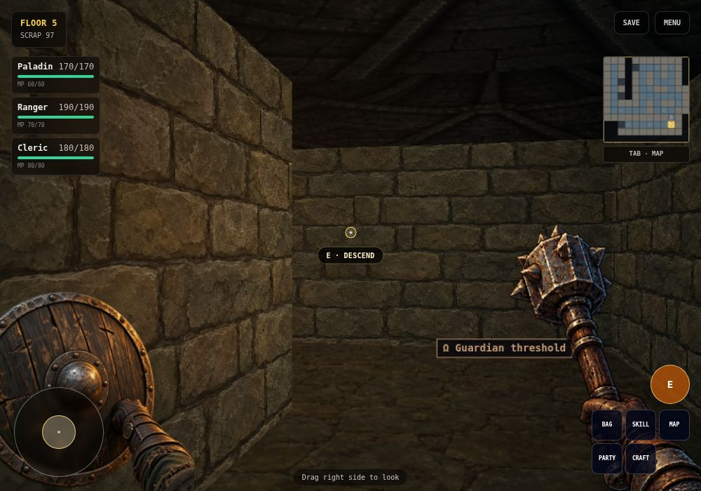
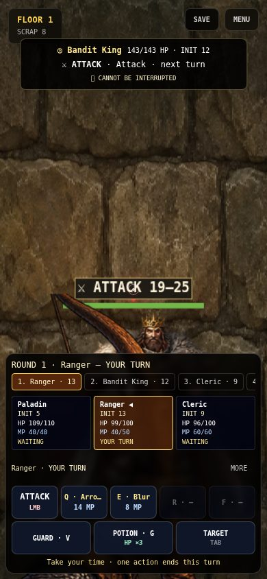
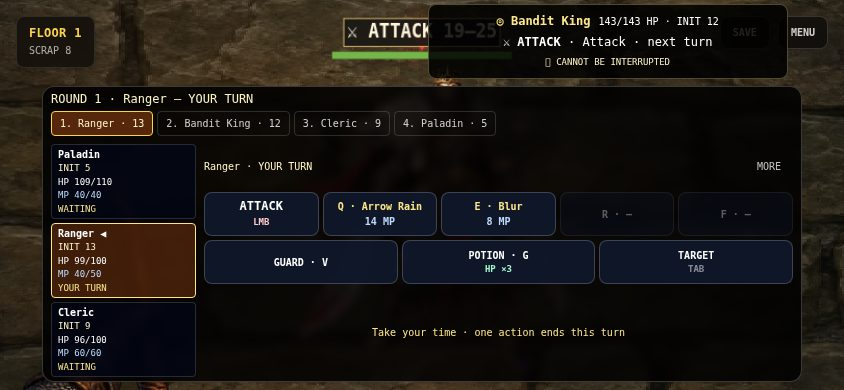

# Floors 1–5 run validation — 2026-10-18

Base: merged PR #10 on `main` (`88189ed`). A normal-start Paladin / Ranger / Cleric expedition has now completed all five floors through the Necromancer using the browser UI. This is **automated integration evidence**, not a manual or physical-phone acceptance claim.

## What was actually played

New Game → three-class selection → Floor 1 → patrols, choices, equipment, perks and guardians → Floors 2–5 → Necromancer victory → exploration save → Continue. No party stat, position, map, resource or reward overrides, no direct calls to gameplay transitions, and no combat-time acceleration were used. Movement/turning, interactions, targeting, skills, inventory, perks and saves used normal keyboard/buttons.

The driver reads React state for routing and diagnostics. It knows the full map, prefers useful loot, distributes equipment and chooses healing/restoration deliberately. It does not reproduce discovery by a new player. Ordinary combat/loot randomness remains unseeded; the recorded seeds reproduce map/room placement, not identical enemy rolls.

A first baseline attempt stopped on Floor 1 when its equipment assertion found that an equipped item retained an entire stack's quantity. That attempt is excluded from acceptance. After the inventory fix a **fresh New Game** began the recorded expedition. On Floor 4 the driver's overly strict heading tolerance oscillated; it was continued from its genuine, unmodified saved game after relaxing that driver tolerance. The same party, dungeon, items, XP and room state continued. No navigation failure was presented as a gameplay blocker.

The two segments are joined in [the run ledger](qa/normal-run.json). A sampled action counter was inaccurate and is omitted rather than reported as a balance metric.

| Floor | Map seed | Victorious encounters | MP at final combat update: Paladin / Ranger / Cleric |
| --- | ---: | ---: | --- |
| 1 | 1372047133 | 3 | 25 / 45 / 45 |
| 2 | 695477773 | 3 | 35 / 47 / 45 |
| 3 | 1976150598 | 4 | 40 / 52 / 50 |
| 4 | 3266253470 | 4 | 33 / 36 / 38 |
| 5 | 2659626991 | 4 | 10 / 9 / 30 |

The final combat update includes the normal level-up's +5 MP where earned, but precedes perk choices. All three heroes survived all **18 encounters**: ten patrols, three optional elites and five guardians. The party reached level 5. There were **31 recorded room decisions** and **six explicit save/reload comparisons**: after every guardian and additionally after Floor-2 treasure. Party data, map and floor state compared equal after Continue, including equipment, keys, resolved rooms and guardian flags.

Treasure and locked vault equipment, Event keys/scrap, Aether Shrine, Secret discovery/safe salvage and safe Hazard tools were used. Blood/Fortune shrine costs were declined; hazardous checks were not attempted in this expedition and remain covered by their existing unit tests. Camps were used for MP meditation on all five floors. Eight of twelve perk choices were Full Restore, trading away permanent upgrades. Crafting, fleeing, party death and other class combinations are not validated by this run.

The actual Necromancer encounter included Curse, Soul Bolt, an ordinary skeleton summon, Phase II, ritual preparation, Mass Raise and Soul Harvest. Summons joined later turns; defeating the boss settled once and returned to the same floor. His 600 HP were depleted through normal attacks/skills, not a strengthened fixture.

## Integration fixes found

### Inventory transactions

Equipping previously copied a stack's quantity into a single slot. Loot merging, equipping/accessory bonuses and scrapping also mutated existing state objects inside React updaters. A replay could corrupt counts or apply stat bonuses again. `services/inventory.ts` now performs pure transactions: one equipped unit, one returned old unit, reversible accessory bonuses, independent resource-cap clamping and immutable stack/scrap operations. Equal names with different gameplay values no longer merge. No attempt is made to infer and repair historically overcounted base stats in old saves.

### Earned skill upgrades and defensive skills

Upgrade perks incremented `skill.level`, but neither actual power nor effect values used it. Each rank now adds **15% of rank-one power/effect strength**, bounded by the authored maximum, with unchanged MP costs. Damage/healing round down; status strengths round to nearest integer. Soul Pact scales its MP restoration at the same rate and retains its 20 HP cost. Old/missing rank metadata safely uses rank one. Combat details, exploration skill details and perk descriptions use/explain the same policy. Perk logs were moved out of replayable state updaters.

`SHIELD` status from Blur/Iron Skin/Arcane Ward previously had no effect on incoming attacks. It now reduces each attack by its authored/upgraded value, after Guard and before equipment, with the existing minimum of 1 damage. It retains existing own-turn expiry, is not a consumable pool, and does not cancel poison/burn. Structured block feedback includes this mitigation. The flat-value interpretation is now explicit; further balance sampling is still needed.

### Door interaction and narrow HUD

An unresolved optional decision underfoot could take every E press before a closed ordinary door ahead, even after leaving the dialog. The interaction ray now lets that door take priority; the declined room remains usable afterward. Locked/secret gate interactions remain room decisions.

HP and MP now occupy separate party-card lines so the narrow combat HUD does not truncate MP. The redundant article in the Necromancer victory message was removed.

## Browser/touch check

The shipped `npm run test:run` driver was also executed against a genuine Floor-1 camp checkpoint in touch-emulated Chromium at **390×844** and **844×390**. An actual CDP touch drag was held across opening/closing the map; movement did not resume afterward. Combat proceeded through a Bandit King victory, ordinary perk choice, save and reload. All **12 visible dock buttons** fit both viewports and measured at least **44×44 CSS pixels**. HP/MP were both visible. Screenshots were inspected. No page exceptions were recorded. See [the touch ledger](qa/touch-run.json).







## Reproduce

```bash
npm install
npx playwright install chromium
npm run test:run
```

This opt-in test starts a local Vite server and uses normal gameplay; allow several minutes. It writes reports, screenshots and actual save checkpoints under ignored `artifacts/run-playtest/`. It does not run as part of the fast unit suite. An installed browser may be supplied with `CHROMIUM_PATH`; `RUN_PORT` changes the local port. The read-only React inspector targets this development app and needs updating if its component/state shapes change.

Optional settings:

- `RUN_TOUCH=1`: touch-emulated portrait movement/map-cancellation and both combat orientations.
- `RUN_OUT=artifacts/another-run`: separate output directory.
- `RUN_SAVE=/absolute/path/to/real-save.json RUN_START=4`: Continue from a real checkpoint. This populates localStorage with that exact saved game, without altering its contents. Set the matching floor number.
- `RUN_END=1`: shorter one-floor check. Fresh New Game otherwise starts at Floor 1 and runs through Floor 5.
- `PLAYWRIGHT_MODULE`: optional path to an existing Playwright installation in a managed environment.

No developer hooks, cheats or React state writers are added to the game. Random seeds/boss variants can change test difficulty; failure preserves a report and screenshot for diagnosis rather than silently granting resources or bypassing content.

## Checks and remaining acceptance

- `npm test`: **130/130**, 15 files, including frozen-input/replayed inventory transactions, skill-rank/SHIELD behavior and the declined-choice/door regression.
- `npm run typecheck`: passed.
- `npm run build`: passed, TypeScript + Vite production output.
- `git diff --check`: passed.
- Actual browser expedition and touch checkpoint run described above: completed.

**Still open:** physical-phone controls/performance/comfort; blind human exploration; multiple seeds and other parties; broader ability/content consistency (including group-heal/Focus descriptions versus legacy behavior), crafting/flee/death balance, and final tuning of AoE, armor and MP sustain. Early rats were repeatedly cleared by one Arrow Rain at 14 MP, but later elite/summon fights consumed substantially more MP. One well-routed party with meditation/restoration does not justify a blanket AoE or enemy-HP nerf. No such global retuning was made.
